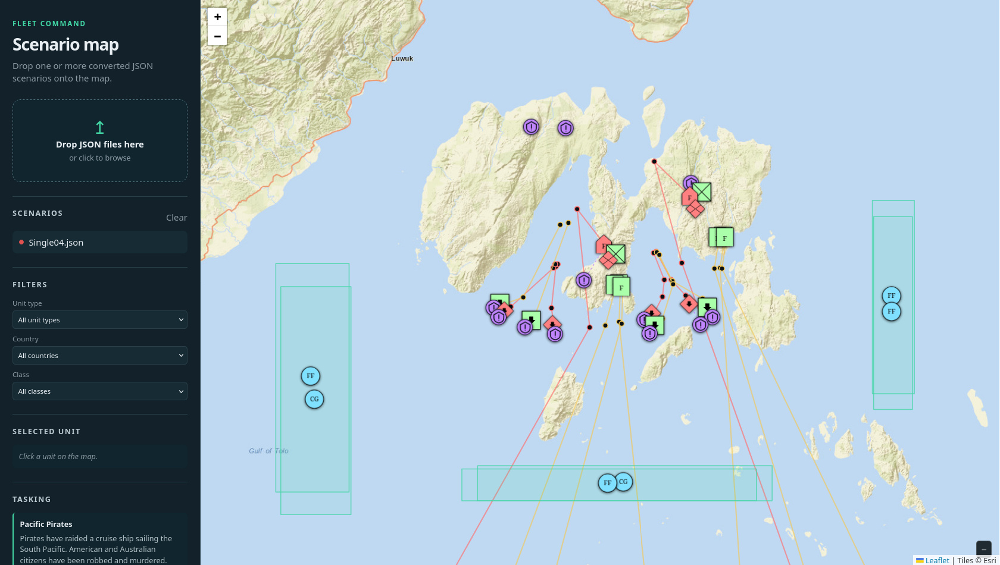

# Fleet Command to Seapower Converter
The goal of this little project is to parse the internal scenario files of the old (but still great) [Fleet Command](https://store.steampowered.com/app/2910/Fleet_Command/) game into mission files for [Sea Power](https://store.steampowered.com/app/1286220/Sea_Power__Naval_Combat_in_the_Missile_Age/).

## Parsing Fleet Command scenarios
This tool parses Fleet Commands `.scs` & .`scm` files into a far easier to work with custom json format.

Please note that because of copyright isues, this repo does not contain the original Fleet Command files or the converted `.json` files. Please acquire a copy of Fleet Command yourself.

## website

This repo also contains a small website to visualize the fleet command scenarios on a map. Simply open the `index.html` file in your browser and drag one of the `.json` files produced by the scs_converter into it.

## Converting to Sea Power missions
This tool generates `.ini` mission files for Sea Power from the `.json` files produced by the scs_converter.

### Caveats
Because these are literally two different games with different units, mechanics and a totally different mission formats a conversion is far from simple and contains a lof of caveats. A lot of things are already handled but some will still need some work. 
Also these missions might be very unbalanced in Sea Power.

- Some units might be incorrect because they were mapped wrong or a generic fallback was used
- Some triggers may be broken
- Some units may spawn on land. This is not a coordinate mapping problem, instead it seems that the map of Fleet Command is a bit incorrect at some places.
- Building & land unit conversion still needs more work. In Fleet Command the buildings were smaller and more numerous, this needs to be correctly handled.
- ...

## Vibe coding disclaimer
To be honest, I vibe coded this project for the most part. If I didn't then I would have probably never made it considering the amount of busy work it requires.

Because of this some of the code quality is not super great and it might be hard to maintain.

But in the end it doesn't need to be perfect.

## Unified CLI

The package exposes one CLI with two subcommands.

    # Convert one scenario
    fleetcommand2seapower parse scenario.scs -o scenario.json

    # Convert every Fleet Command scenario in a directory
    fleetcommand2seapower parse /path/to/scenario --output-dir converted-json

    # Generate one mission; scenario files are converted implicitly through JSON
    fleetcommand2seapower convert scenario.scs scenario.ini

    # Generate missions from a directory of scenarios or JSON files
    fleetcommand2seapower convert converted-json --output-dir missions

When the SCS converter input is omitted, it uses the default Steam installation directory:

- Linux: `~/.local/share/Steam/steamapps/common/Fleet Command/scenario`
- Windows: `%PROGRAMFILES(X86)%\\Steam\\steamapps\\common\\Fleet Command\\scenario` (falling back to `%PROGRAMFILES%`)

## Current Python CLI

The package exposes exactly two subcommands:

    fleetcommand2seapower parse [INPUT] [--output-dir OUTPUT_DIR]
    fleetcommand2seapower convert [INPUT] [OUTPUT] [--output-dir OUTPUT_DIR]

parse converts Fleet Command `.scs`, `.sct`, `.scm`, and `.scc` files to `JSON`. When `INPUT` is omitted, it uses:

- Linux: `~/.local/share/Steam/steamapps/common/Fleet Command/scenario`
- Windows: `%PROGRAMFILES(X86)%\\Steam\\steamapps\\common\\Fleet Command\\scenario` (falling back to `%PROGRAMFILES%`)

Batch parsing also creates _info.ini in the output directory. Scenario filenames are trimmed of leading and trailing whitespace when output files are created.

convert accepts JSON files, Fleet Command scenario files, or directories containing either. Scenario files are implicitly parsed to JSON strings before mission generation. Its default mission year is 1986. Sea Power assets default to:

- Linux: `~/.local/share/Steam/steamapps/common/Sea Power/Sea Power_Data/StreamingAssets/original`
- Windows: `%PROGRAMFILES(X86)%\\Steam\\steamapps\\common\\Sea Power\\Sea Power_Data\\StreamingAssets\\original` (falling back to `%PROGRAMFILES%`)

The unit mapping is bundled with the package. Use `--mapping` or `--streaming-assets` to override the defaults.

Warnings and errors are emitted with Python logging to stdout. No warning log file is created. Batch conversion writes `quality_report.json` only when `--debug` is supplied.

Examples:

    fleetcommand2seapower parse
    fleetcommand2seapower parse /path/to/scenarios --output-dir converted-json
    fleetcommand2seapower convert /path/to/scenarios --output-dir missions
    fleetcommand2seapower convert /path/to/scenarios --output-dir missions --debug
